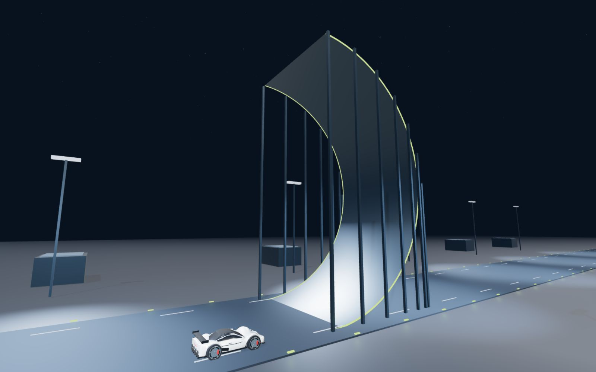

# Tesla Can Fly

**English** · [简体中文](README.zh-CN.md)

A browser driving challenge inspired by the flying Roadster concept: climb a suction ramp, control the car in mid-air, and stop inside the landing zone.

Built with **Astro**, **Three.js**, and **pnpm**. The landing pages are static; the 3D game loads only on the play pages. The project uses simplified game physics and is independently made, with no affiliation with Tesla or SpaceX.



## Features

- English and Simplified Chinese pages, with language suggestions based on browser preferences.
- A complete automatic demo with pause, replay, and multiple camera views.
- Keyboard controls on desktop; touch controls in mobile landscape.
- Portrait viewing mode that prompts players to rotate before driving.
- Suction, limited cold-gas thrust, attitude control, ramp collision checks, and landing feedback.
- Predicted and actual touchdown markers, plus whole-car stopping checks inside the green zone.
- Static deployment to Cloudflare Workers, without SSR or a database.

## Demo videos

- [Chinese portrait demo — MP4](videos/tesla-can-fly-zh-xiaohongshu.mp4)
- [English landscape demo — MP4](videos/tesla-can-fly-en-x.mp4)

Both clips capture the actual in-game scene and include localized captions and telemetry. They are silent H.264 videos at 30 fps.

## Quick start

Requires **Node.js 22.12+** and **pnpm 9.15.1**.

```sh
pnpm install
pnpm dev
```

Open [localhost:3000](http://127.0.0.1:3000/). The root page selects a homepage using a saved language preference or the first supported browser language. With JavaScript disabled, it provides language links instead.

| Route | Page |
| --- | --- |
| `/en/` | English landing page |
| `/zh/` | Chinese landing page |
| `/en/play/` | English game |
| `/zh/play/` | Chinese game |

The homepage CTA opens the corresponding game page. The game’s brand link returns home. Unknown routes return a separate 404 page.

## Controls

| Input | Action |
| --- | --- |
| W / S | Accelerate / brake |
| A / D | Steer or move sideways |
| Shift | Hold suction on the ramp |
| Space | Thrust in the direction of the car’s local up axis |
| Left / right arrows | Roll in the air |
| Up / down arrows | Pitch in the air |
| R | Restart the current mode |
| C | Cycle cameras, including a close-up view |
| P | Pause / resume the automatic demo |

In mobile landscape, use the pedals, suction toggle, attitude stick, thrust button, and lateral controls. Portrait mode is watch-only. Rotating back to portrait ends the manual attempt, releases inputs, and returns to the demo.

To complete a run, keep suction engaged through the inverted section and stop with the entire car inside the green zone. Landing feedback explains failed checks and their limits. The amber marker predicts touchdown using the current attitude and thrust input; the cyan marker preserves the actual contact point.

## Language behavior

The URL determines the page language. Switching languages preserves the page path, such as `/en/play/` → `/zh/play/`, and saves the preference locally. If the current page differs from a supported browser language, the site offers a switch instead of forcing a redirect. Dismissing the suggestion suppresses it for that language pair during the current browser session.

## Build and verify

```sh
pnpm test
pnpm build
pnpm verify:build
pnpm preview
```

The tests cover ramp contact, challenge qualification, stopping bounds, landing prediction, and locale selection. `verify:build` checks the generated bilingual routes, CTA links, game entry points, landing-page separation, and Worker asset configuration.

## Deploy to Cloudflare Workers

```sh
pnpm build
pnpm cf:preview
```

The local Worker preview uses port 8787. After signing in to your Cloudflare account:

```sh
pnpm exec wrangler login
pnpm deploy
```

`wrangler.jsonc` serves `dist/` as static assets with trailing-slash URLs and a dedicated 404 page. It does not require a server-rendering adapter or a Worker entry point. Change the Worker name before deploying if needed.

For Workers Builds, use `pnpm build` as the build command and `pnpm exec wrangler deploy` as the deploy command. A configuration-only dry run is available with:

```sh
pnpm exec wrangler deploy --dry-run
```

## Project structure

```text
src/
  pages/
    index.astro                 Language entry page
    404.astro                   Not-found page
    [lang]/index.astro          Landing page
    [lang]/play.astro           Game page
  layouts/SiteLayout.astro      Shared site navigation, metadata and footer
  components/Game.astro         Game HUD and script entry
  styles/site.css              Landing-page styles
  main.js                      Scene, simulation and camera loop
  vehicle.js                   Procedural Roadster model
  collision.js                 Ramp geometry and collision helpers
  challenge.js                 Landing checks and trajectory prediction
  locale.js                    Shared locale selection rules
  i18n.js                      Game translations and language switching
  touch.js                     Pointer controls and input cleanup
  recording.js                 Opt-in demo recording
  style.css                    Game styles
public/images/                 Static landing-page imagery
scripts/verify-build.mjs        Static output checks
videos/                        Exported demos
qa/                            Visual QA screenshots
```

Add future content pages under `src/pages/[lang]/`, generate both languages with `getStaticPaths()`, and reuse `SiteLayout`. Keep page links language-prefixed. After choosing a public domain, add absolute canonical URLs, a sitemap, and social sharing metadata as needed.

## Record a demo

Open `/zh/play/?record=1` or `/en/play/?record=1`, choose a portrait or landscape viewport **before loading the page**, then click the recording button. The utility records one complete automatic run as WebM, including localized captions and telemetry, without browser controls. Recording is opt-in and does not request microphone access.

Convert the download to MP4 with FFmpeg:

```sh
ffmpeg -i recording.webm -c:v libx264 -crf 19 -pix_fmt yuv420p -r 30 -movflags +faststart demo.mp4
```

`/en/play/?poster=1` shows a parked close-up without the HUD for generating screenshots.

## Simulation scope

Mobile and narrow-screen sessions default to a lightweight render profile: no real-time shadow maps or dynamic spotlights, antialiasing and a pixel ratio capped at 1.5, and batched static geometry. HUD and landing prediction refresh at 10 Hz while driving input and simulation continue every frame. Hidden tabs stop rendering. `?quality=low` can force this profile on desktop; `?perf=1` displays local renderer counters for diagnostics.

The ramp uses a constrained path with clearance compensation and swept collision probes. Airborne motion uses simplified gravity, thrust, and attitude input. It does not model full tyre dynamics, aerodynamic flow, or real vehicle performance. The vehicle is a procedural approximation rather than a manufacturer-supplied model.

## License

[MIT](LICENSE) © 2026 panyanyany. Third-party dependencies retain their own licenses.

## Project notices

English and Chinese disclaimer and privacy pages are available at `/{lang}/disclaimer/` and `/{lang}/privacy/`. Links appear in the site footer and the game information menu. These notices are not third-party brand permissions or a guarantee of legal compliance.
